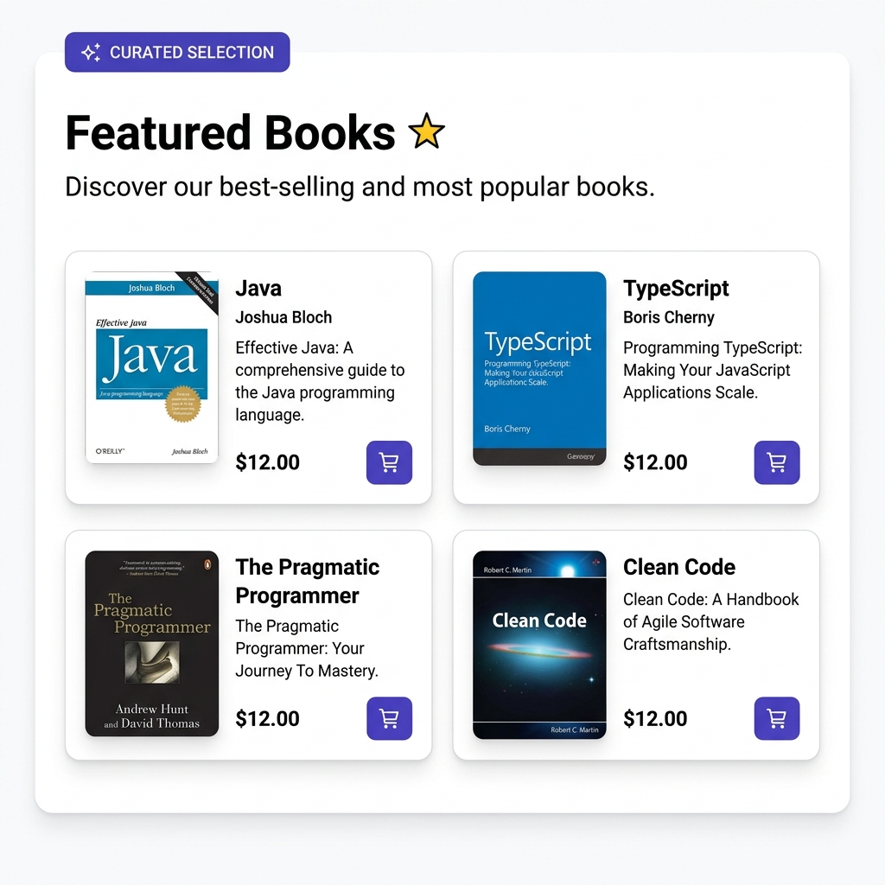
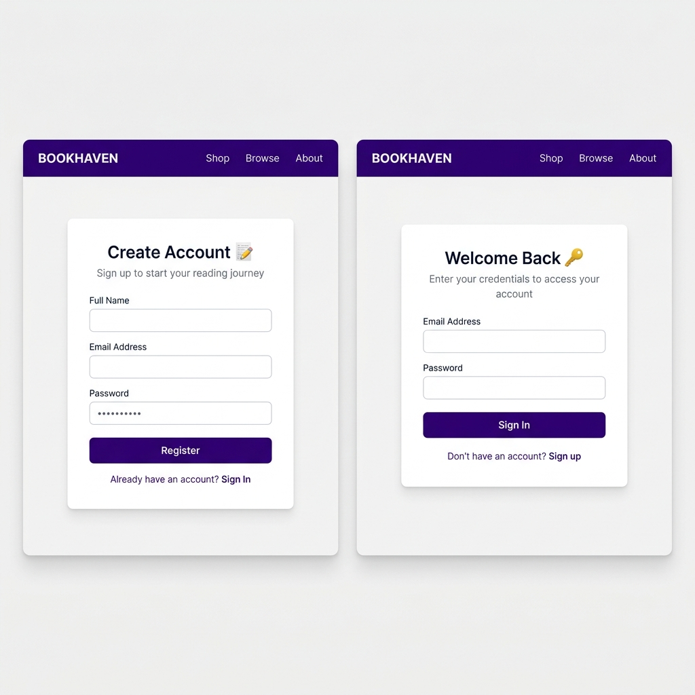
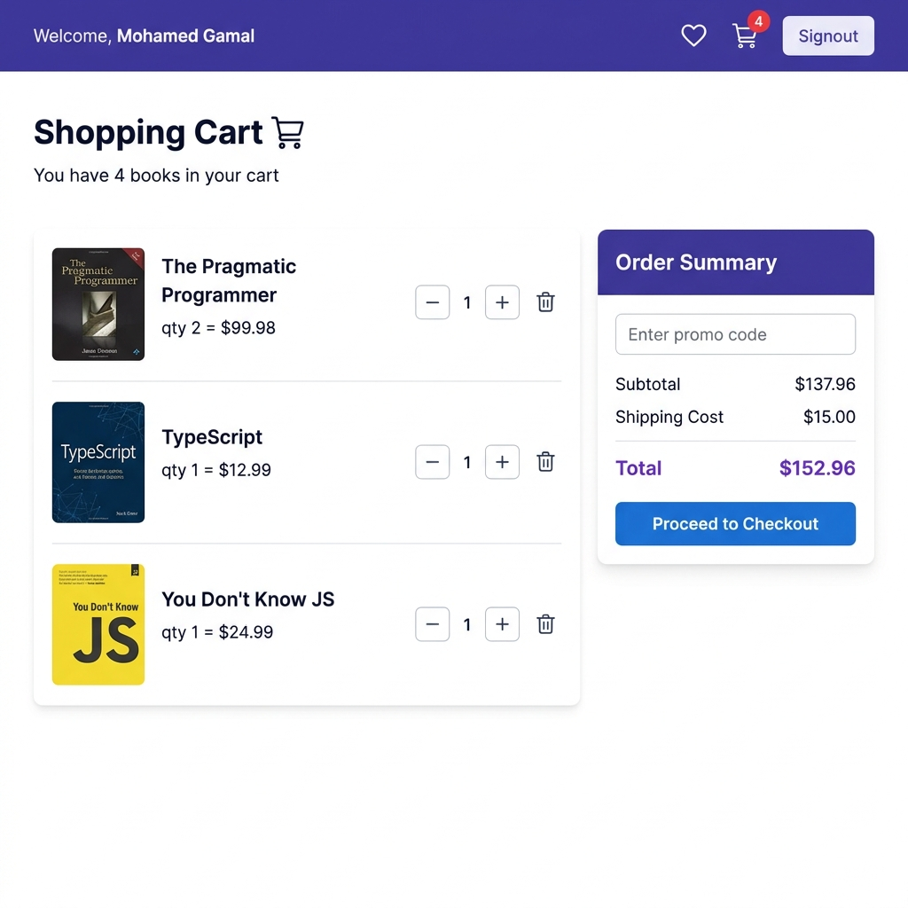
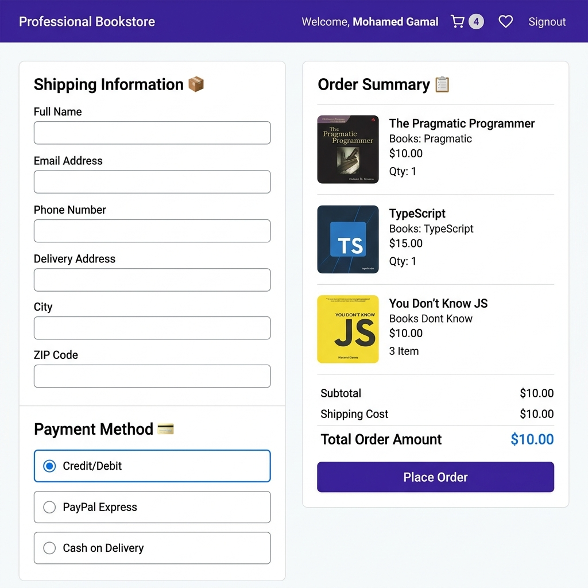
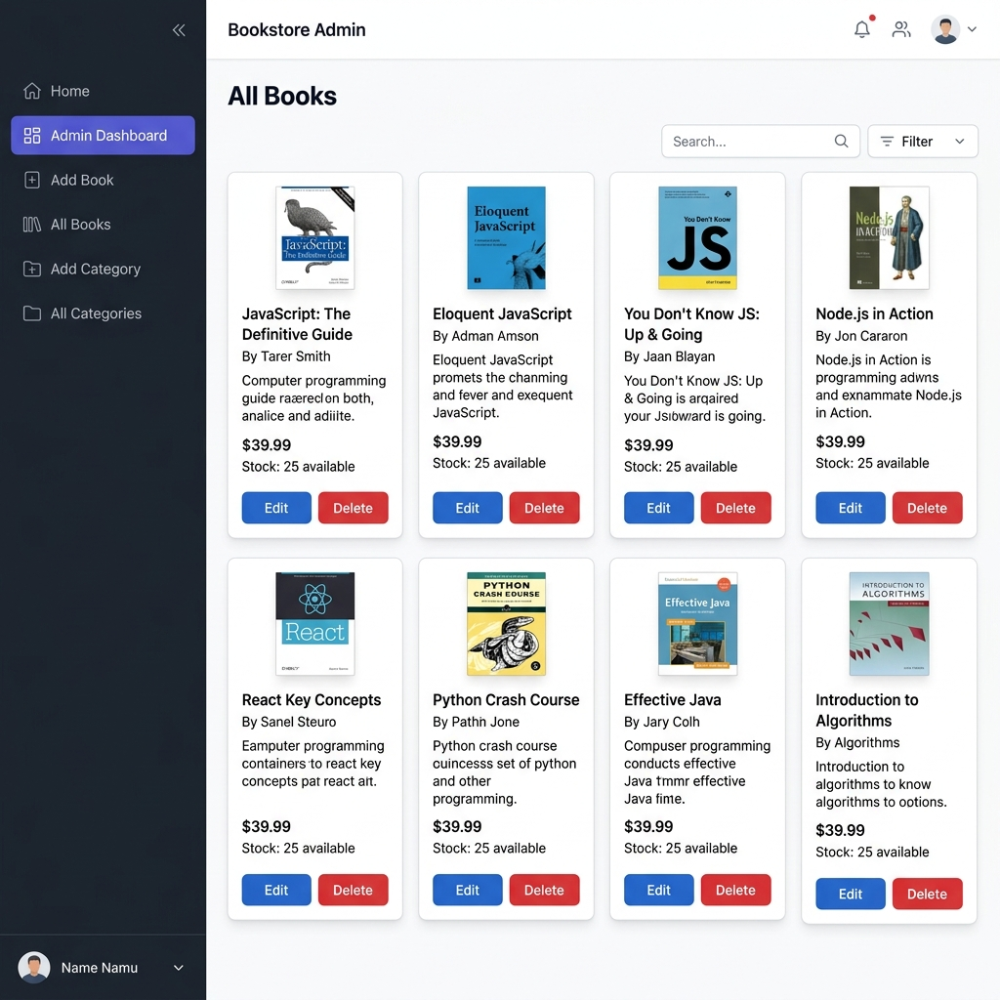

<div align="center">

# 📚 BookStore

### A full-stack e-commerce platform for buying and managing programming books

<br/>

<!-- Tech Stack Badges -->


<br/><br/>


</div>

---

## 📸 Screenshots

### 🏠 Home Page



### 🔐 Authentication


### 🛒 Shopping Experience



### 🔑 Admin Panel


---

## ✨ Features

### 🛍️ Customer Features
| Feature | Description |
|---|---|
| 📖 **Browse Books** | Explore a rich catalog with category filtering, search & sort |
| 🔍 **Book Details** | Detailed view with description, price, author info |
| 🛒 **Shopping Cart** | Add/remove books, update quantities, view running total |
| ❤️ **Wishlist** | Save favorite books with heart toggle (localStorage) |
| 💳 **Checkout** | Place orders with shipping info & payment method selection |
| 🔐 **Authentication** | Secure sign-up / sign-in with JWT in HTTP-only cookies |
| 👤 **User Profile** | View account info and full order history |
| 📱 **Responsive** | Fully optimized for mobile, tablet, and desktop |

### 🔑 Admin Features
| Feature | Description |
|---|---|
| 📊 **Dashboard** | Overview of all books in the store |
| ➕ **Add / Edit Books** | Full CRUD with image upload via Multer |
| 🏷️ **Categories** | Create and manage book categories |
| 🗑️ **Delete Books** | Remove books from the catalog instantly |

### ⚙️ Technical Highlights
- 🔒 **JWT Authentication** via secure HTTP-only cookies
- 🔄 **Cart isolation per user** — resets cleanly on login/logout
- 📦 **Order persistence** — saved to MongoDB after checkout
- ⚡ **Debounced search** — smooth search without excess API calls
- 💀 **Skeleton loaders** — perceived performance during data fetch
- 🛡️ **Error Boundary** — graceful fallback for unexpected UI errors
- 🔔 **Toast notifications** — real-time feedback via `react-toastify`
- 🧩 **Atomic Design** — reusable component architecture

---

## 🛠️ Tech Stack

<table>
  <tr>
    <th>Layer</th>
    <th>Technology</th>
    <th>Purpose</th>
  </tr>
  <tr>
    <td><b>🎨 Frontend</b></td>
    <td>
      
      
    </td>
    <td>UI & Routing</td>
  </tr>
  <tr>
    <td><b>🎨 Styling</b></td>
    <td>
      
    </td>
    <td>Utility-first inline styles</td>
  </tr>
  <tr>
    <td><b>⚙️ Backend</b></td>
    <td>
      
      
    </td>
    <td>REST API Server</td>
  </tr>
  <tr>
    <td><b>🗄️ Database</b></td>
    <td>
      
      
    </td>
    <td>NoSQL Database & ODM</td>
  </tr>
  <tr>
    <td><b>🔐 Auth</b></td>
    <td>
      
      
    </td>
    <td>Token Auth + Password Hashing</td>
  </tr>
  <tr>
    <td><b>📡 HTTP Client</b></td>
    <td>
      
    </td>
    <td>API Requests</td>
  </tr>
  <tr>
    <td><b>📁 File Upload</b></td>
    <td>
      
    </td>
    <td>Book cover image uploads</td>
  </tr>
  <tr>
    <td><b>🔔 Notifications</b></td>
    <td>
      
    </td>
    <td>Toast alerts</td>
  </tr>
  <tr>
    <td><b>🎯 Icons</b></td>
    <td>
      
    </td>
    <td>UI Icons</td>
  </tr>
</table>

---

## 📁 Project Structure

```
BookStore/
├── 📁 backend/
│   ├── config/          # Database connection (MongoDB Atlas)
│   ├── controller/      # Route handlers (books, users, cart, orders, categories)
│   ├── images/          # Uploaded book cover images
│   ├── middleware/       # JWT authentication middleware
│   ├── model/           # Mongoose schemas (Book, User, Cart, Order, Category)
│   ├── routes/          # Express route definitions
│   ├── .env.example     # ← Environment variable template (copy to .env)
│   └── server.js        # App entry point
│
└── 📁 frontend/
    └── src/
        ├── api/              # Axios instance + image URL helper
        ├── components/       # Atomic Design components
        │   ├── header/       # DesktopHeader, MobileHeader, MobileMenu
        │   ├── ui/           # BookCard, Button, Input, Card, Skeleton
        │   ├── admin/        # Admin CRUD components
        │   └── ...           # Hero, Footer, FAQ, Testimonials, etc.
        ├── context/          # AuthContext, CartContext, WishlistContext
        ├── pages/            # Route-level pages
        │   ├── home, products, cart, checkout
        │   ├── wishlist, profile, about, contact
        │   └── signin, signup, bookDetails, notFound
        └── utils/            # useDebounce hook, cn utility
```

---

## 🚀 Getting Started

### Prerequisites


### 1. Clone the Repository

```bash
git clone https://github.com/MG-0/Book-Store-Mern-App.git
cd Book-Store-Mern-App
```

### 2. Configure & Run the Backend

```bash
cd backend
cp .env.example .env   # Then fill in your values
npm install
npm run dev
```

The backend runs at: **`http://localhost:5000`**

`.env` file structure:

```env
PORT=5000
MONGO_URI=mongodb+srv://<user>:<password>@<cluster>.mongodb.net/bookstore
JWT_KEY=your_super_secret_jwt_key
```

### 3. Configure & Run the Frontend

```bash
cd ../frontend
# Create frontend/.env with:
# REACT_APP_API_URL=http://localhost:5000
npm install
npm start
```

The frontend runs at: **`http://localhost:3000`**

> ⚠️ Make sure the backend is running before starting the frontend.

---

## 🔑 Environment Variables

| Variable | Where | Description |
|----------|-------|-------------|
| `PORT` | `backend/.env` | Express server port (default: 5000) |
| `MONGO_URI` | `backend/.env` | MongoDB Atlas connection string |
| `JWT_KEY` | `backend/.env` | Secret key for signing JWT tokens |
| `REACT_APP_API_URL` | `frontend/.env` | Backend API base URL |

> 📄 See [`backend/.env.example`](./backend/.env.example) for the full template.

---

## 🔗 API Endpoints

| Method | Endpoint | Description | Auth |
|--------|----------|-------------|------|
| `POST` | `/users/register` | Register a new user | ❌ |
| `POST` | `/users/login` | Login and receive JWT cookie | ❌ |
| `POST` | `/users/logout` | Clear auth cookie | ✅ |
| `GET` | `/books/getBooks` | Get all books | ❌ |
| `GET` | `/books/getBook/:id` | Get single book | ❌ |
| `POST` | `/admin/addBook` | Add a new book | ✅ Admin |
| `PUT` | `/admin/updateBook/:id` | Update a book | ✅ Admin |
| `DELETE` | `/admin/deleteBook/:id` | Delete a book | ✅ Admin |
| `GET` | `/cart/getCart` | Get user's cart | ✅ |
| `POST` | `/cart/addToCart` | Add book to cart | ✅ |
| `POST` | `/orders/placeOrder` | Place an order | ✅ |
| `GET` | `/orders/myOrders` | Get user's orders | ✅ |

---

## 🤝 Contributing

Pull requests are welcome! For major changes, please open an issue first.

1. Fork the repository
2. Create your branch: `git checkout -b feature/amazing-feature`
3. Commit: `git commit -m "feat: add amazing feature"`
4. Push: `git push origin feature/amazing-feature`
5. Open a Pull Request

---

## 📄 License

This project is licensed under the [MIT License](LICENSE).

---

<div align="center">
  <br/>
  Made with ❤️ using the MERN Stack
  <br/><br/>
  
  
  
  
</div>
